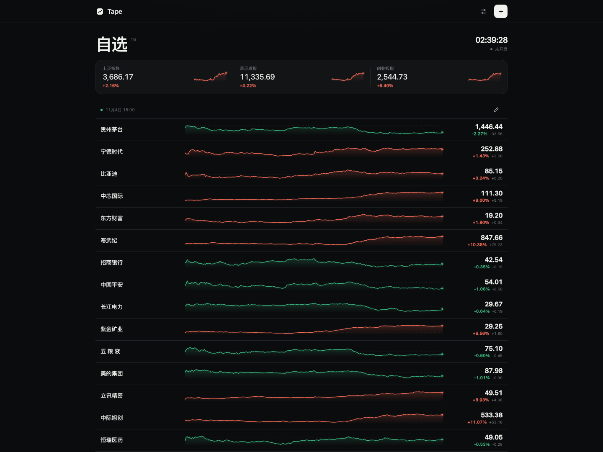
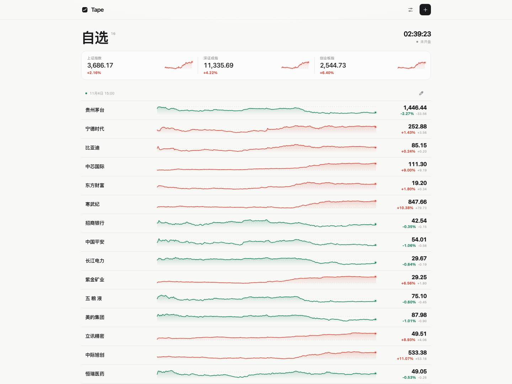
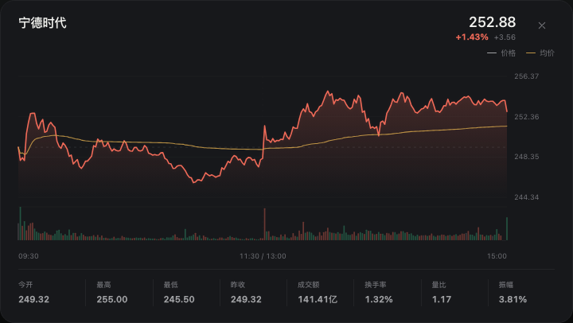
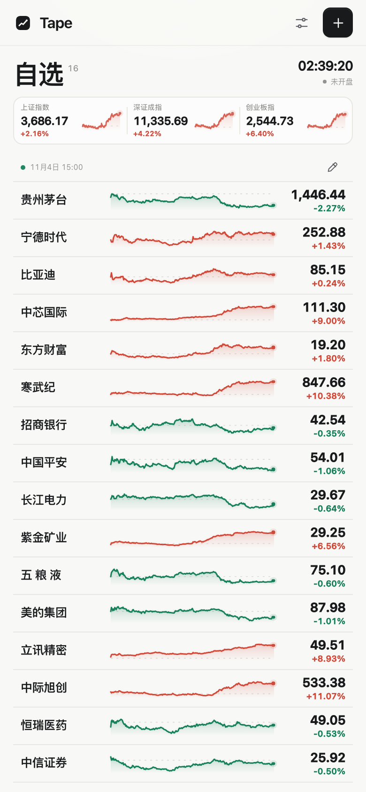
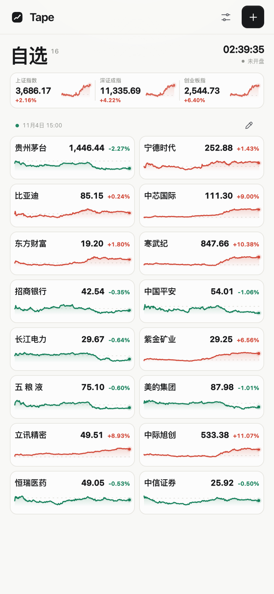
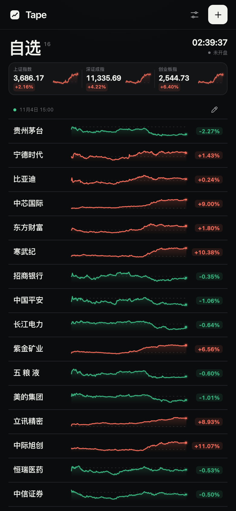

# Tape

**一列股票，一眼看清。**

为 A 股日内盯盘而做的极简自选行情页。没有资讯流、没有多余面板——只有一列高密度、可直接对比的走势带。

[](https://github.com/yorhaha/stock-watch/actions/workflows/deploy.yml)
[](https://yorhaha.github.io/stock-watch/)



## 为什么是 Tape

盯盘时最常做的动作，是**在一组股票之间来回扫一眼**：谁在拉升，谁在跳水，谁还在横盘。

大部分行情页把这件事拆成了点击、切换和很多块信息。Tape 把它重新压回一个动作：一列股票，每只固定一行，完整分时线、价格与涨跌同时可见。需要更多信息时，点击打开独立分时详情层，不改变列表密度。也可以切换双列，把更多标的收进同一屏。

围绕这个目标，项目只保留三件事：

- **一眼可比较**：统一的时间轴、昨收基准线和涨跌色，让每只股票的形状可以直接纵向对比。
- **一行有深度**：点击打开分时详情层，保留完整图表、成交量与关键指标，列表仍是单行。
- **没有多余步骤**：`⌘K` 添加，方向键浏览，回车打开详情；自选与偏好自动保存在本地。

## 功能

- **单行走势带**：默认单列时每只股票固定一行，一条当日分时 Sparkline，带昨收虚线基准，红涨绿跌一眼可辨；界面不显示股票代码。
- **指数实时走势**：上证指数、深证成指、创业板指均带实时分时缩略线与涨跌，桌面与手机一致。
- **单屏 15+**：默认 16 只股票；390×844 移动端首屏 16 行全部可见，1440×1080 桌面首屏 15 行完整可见。
- **独立分时详情**：价格线、均价线、成交量、今开 / 最高 / 最低 / 昨收 / 成交额 / 换手 / 量比 / 振幅，以及逐分钟悬停详情。
- **实时刷新**：盘中行情每 3–10 秒刷新（可设置），分时图约每 30 秒同步；页面隐藏时暂停请求，回到前台立即补刷。
- **沪深京 A 股搜索**：支持股票名称、拼音与 6 位代码，搜索即添加。最多可放 30 只股票。
- **自选管理**：拖动排序，或使用上下箭头调整；移除后可在 Toast 中撤销。
- **明暗主题**：自动跟随系统，也可手动固定浅色 / 深色。
- **涨跌颜色可切换**：默认 A 股习惯「红涨绿跌」，也支持国际习惯「绿涨红跌」。
- **显示自定义**：隐藏价格、为涨跌幅增加背景色块、切换单列 / 双列，全部即时生效并保存。
- **键盘操作**：`⌘K` / `/` 添加，`↑` `↓` 浏览，`↵` 打开详情，`Esc` 关闭。
- **移动优先**：手机端以 40px 行高呈现单行行情；短屏设备自动收起标题区，优先保证股票列表。
- **没有说明文字**：界面只保留数据、标题与操作图标。状态、路径和结构由布局自己表达。
- **Agent 可读**：行情行与指数暴露 `data-secid`、`data-price`、`data-pct`、`data-status`、`data-market-phase`、`data-show-price`、`data-change-bg`、`data-layout` 等稳定属性，便于自动化检查与 AI Agent 读取。
- **纯静态**：Next.js 静态导出，无服务端、无数据库，直接部署 GitHub Pages。

## 预览

| 浅色 | 深色 |
| --- | --- |
|  |  |



<p align="center">
  
  
</p>

<p align="center">
  
</p>

## 本地运行

```bash
npm install
npm run dev
```

打开 [http://localhost:3000](http://localhost:3000)。

检查类型并构建静态产物：

```bash
npm run typecheck
npm run build
```

静态文件会生成在 `out/`。

## 部署到 GitHub Pages

仓库已包含 [`.github/workflows/deploy.yml`](.github/workflows/deploy.yml)。推送到 `main` 后：

1. 打开仓库 **Settings → Pages**。
2. 将 **Source** 设为 **GitHub Actions**。
3. 等待 `Deploy to GitHub Pages` 工作流完成。

工作流会把 Pages 提供的 `base_path` 注入 `NEXT_PUBLIC_BASE_PATH`，所以项目站点路径（如 `/stock-watch`）下的 JS、CSS、图标与 manifest 都能正确加载。

如需手动构建项目站点：

```bash
NEXT_PUBLIC_BASE_PATH=/stock-watch npm run build
```

## 技术结构

```text
app/
  layout.tsx          # 元信息、主题预置、字体与全局样式入口
  page.tsx            # 静态首页
components/
  WatchlistApp.tsx    # 页面编排、键盘交互、Toast、编辑模式
  StockRow.tsx        # 单行行情带
  StockDetailSheet.tsx # 独立分时详情层
  Sparkline.tsx       # 列表用分时缩略线
  DetailChart.tsx     # 分时主图、成交量、悬停十字线
  AddStockDialog.tsx  # ⌘K 搜索添加
  SettingsPopover.tsx # 主题、涨跌色、价格、色块、布局、刷新
  IndexStrip.tsx      # 三大指数
  MarketClock.tsx     # 上海时间与市场状态
hooks/
  useMarketData.ts    # 批量行情、分时、轮询与页面可见性
  useWatchlist.ts     # 自选持久化
  usePreferences.ts   # 主题与显示偏好
lib/
  eastmoney.ts        # 行情 / 分时 / 搜索数据源
  chart.ts            # 纯函数图表几何计算
  market.ts           # 交易时段、格式化、默认自选
```

设计上刻意没有引入 UI 组件库或图表库：图表路径、布局、动效与交互都由少量纯函数和 CSS 实现。这样页面没有运行时框架负担，视觉也能保持统一。

界面不靠文案解释行为：添加是右上角唯一的实心按钮，铅笔进入编辑，点击任意股票打开分时详情，图表本身就是分时结构。所有说明文字都由更直接的布局和图标替代。

## 数据说明

- 行情、分时与股票搜索均来自**东方财富公开接口**，在浏览器端直接请求，项目本身不存储任何行情数据。
- 公开接口可能变更、限流或出现延迟，页面会在连接异常时保留最近一次数据并提示重试。
- 交易日状态按北京时间与工作日推算，未接入单独的节假日日历。
- 本项目仅用于学习与个人看盘，**不构成任何投资建议**。

## License

[MIT](LICENSE) © 2026 yorhaha
